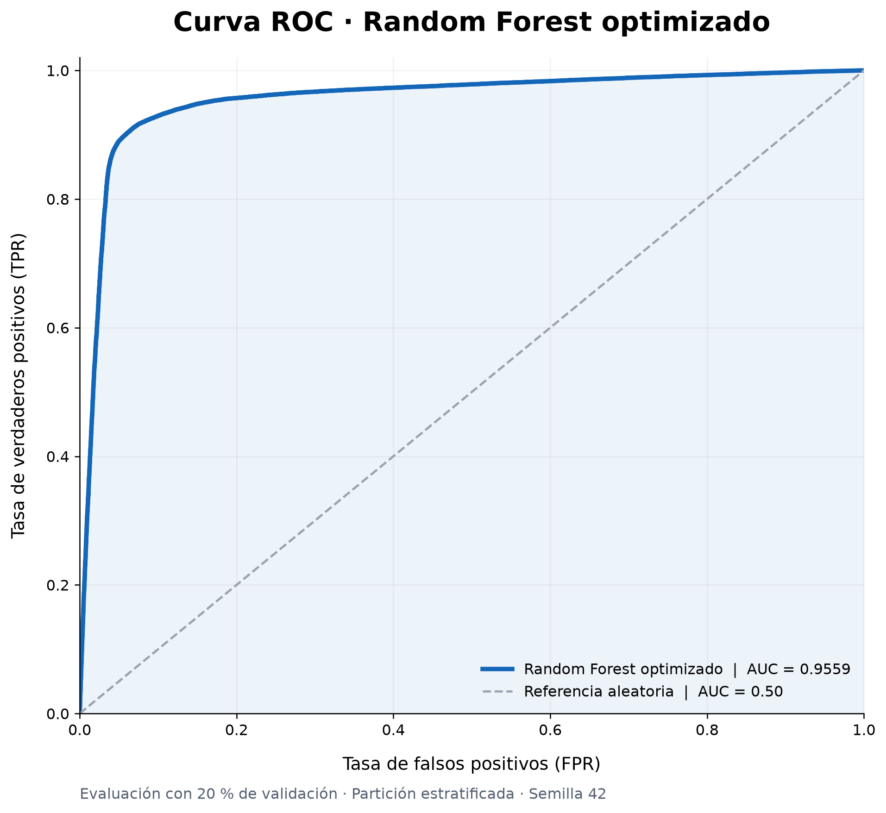
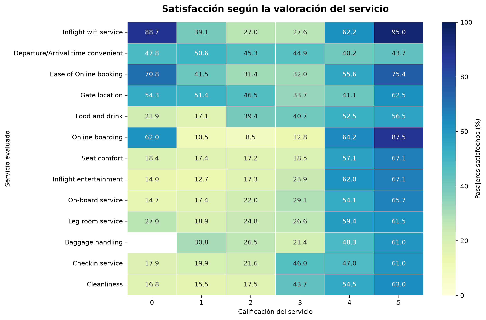
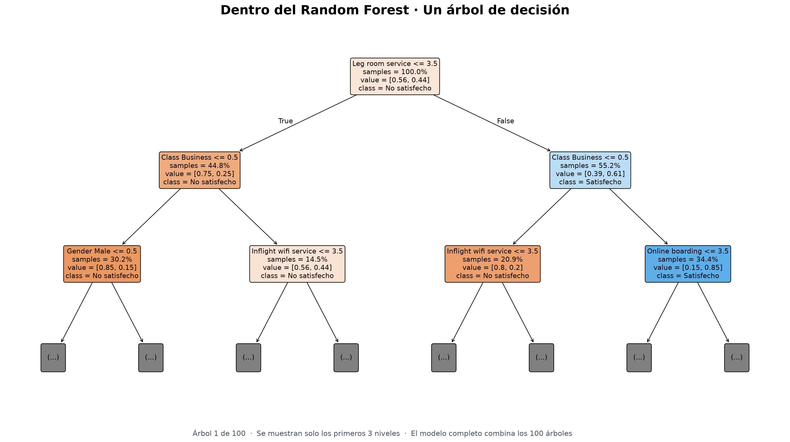

# Predicting Airline Satisfaction

**Predicción de la satisfacción de pasajeros con Machine Learning | Kaggle Playground Series S6E10**

En este proyecto trabajo con datos de pasajeros para entender qué factores se relacionan con su satisfacción y construir modelos de clasificación binaria. El desarrollo está organizado en cuatro notebooks: exploración, preprocesamiento, modelado y predicción final. El objetivo fue recorrer el proceso completo y comparar los resultados de forma clara y reproducible.

> **Mejor modelo: Random Forest optimizado**  
> **ROC-AUC promedio en validación cruzada: 0.956819**  
> **ROC-AUC en validación: 0.955916**
>
> Estas cifras son de la evaluación local. No corresponden a una puntuación del leaderboard de Kaggle.

<p align="center">
  
</p>

## Problema y conjunto de datos

El reto consiste en estimar la probabilidad de que un pasajero esté **satisfecho (`True`)** o **insatisfecho (`False`)** con su experiencia de vuelo. La métrica de comparación principal es **ROC-AUC**, que mide la capacidad de distinguir las dos clases a partir de las probabilidades estimadas.

Los archivos provienen de la competencia [**Predicting Airline Satisfaction - Kaggle Playground Series S6E10**](https://www.kaggle.com/competitions/playground-series-s6e10/overview).

| Conjunto | Registros | Columnas | Uso |
|:--|--:|--:|:--|
| `train.csv` | 699,635 | 23 | Entrenamiento y evaluación; incluye `satisfaction` |
| `test.csv` | 299,844 | 22 | Predicciones para Kaggle; no incluye la etiqueta |

Se utilizaron **21 variables predictoras**: 17 numéricas y 4 categóricas, sin usar `id` como predictor. En los datos de entrenamiento, el **44.36 %** de los registros corresponde a pasajeros satisfechos; se encontraron **292 valores faltantes** en `Arrival Delay in Minutes`.

## Cómo desarrollamos el proyecto

| Etapa | Qué se hizo | Notebook |
|:--|:--|:--|
| **1. Exploración (EDA)** | Calidad de datos, distribuciones, tasas de satisfacción, servicios, correlaciones y gráficas | [`01_exploracion.ipynb`](notebooks/01_exploracion.ipynb) |
| **2. Preprocesamiento** | Partición estratificada 80/20, imputación con mediana, One-Hot Encoding y almacenamiento de los datos transformados | [`02_preprocessing.ipynb`](notebooks/02_preprocessing.ipynb) |
| **3. Modelado** | Regresión Logística, Random Forest, métricas de clasificación, Pipelines, validación cruzada y búsqueda de hiperparámetros | [`03_modelado.ipynb`](notebooks/03_modelado.ipynb) |
| **4. Predicción final** | Reentrenamiento con todos los datos etiquetados, curva ROC, visualización de un árbol y exportación de `submission.csv` | [`04_submission.ipynb`](notebooks/04_submission.ipynb) |

El preprocesamiento se ajusta con datos de entrenamiento y se aplica después a validación, evitando utilizar información de validación para aprender medianas o categorías. Durante la validación cruzada, esta separación se mantiene mediante **Pipelines** y **ColumnTransformer**.

## Resultados de los modelos

Evaluamos dos algoritmos, cada uno con su versión inicial y optimizada. La comparación utiliza el mismo criterio de ROC-AUC y una validación cruzada estratificada de tres folds sobre el conjunto de entrenamiento.

| Modelo | ROC-AUC promedio CV | ROC-AUC validación |
|:--|--:|--:|
| Regresión Logística inicial (Pipeline) | 0.921857 | 0.920455 |
| Regresión Logística optimizada | 0.921859 | 0.920457 |
| Random Forest inicial | 0.955796 | 0.954595 |
| **Random Forest optimizado** | **0.956819** | **0.955916** |

**Selección final:** Random Forest optimizado, al registrar el mejor ROC-AUC promedio de validación cruzada entre las configuraciones evaluadas. En la búsqueda aleatoria se probaron **5 configuraciones** de un espacio de **36** posibles, y se seleccionaron los siguientes hiperparámetros:

| Hiperparámetro | Valor |
|:--|--:|
| `n_estimators` | 100 |
| `max_depth` | 16 |
| `min_samples_split` | 5 |
| `min_samples_leaf` | 4 |

Para Regresión Logística se utilizó `GridSearchCV` sobre el parámetro `C`. La mejor opción encontrada fue `C=0.01`, pero su diferencia de ROC-AUC frente al modelo inicial fue prácticamente nula.

**Nota:** ROC-AUC no es el porcentaje de predicciones correctas (*accuracy*). Los resultados de validación no garantizan una puntuación idéntica en datos nuevos. En esta versión no se realizó Feature Engineering ni se entrenó XGBoost.

## Visualizaciones

### Relación entre la experiencia de servicio y la satisfacción

<p align="center">
  
</p>

En el análisis exploratorio, `Online boarding` fue una de las características con asociación más alta con la satisfacción. Estas relaciones son descriptivas, no pruebas de causalidad.

### Un árbol del Random Forest

<p align="center">
  
</p>

La figura muestra los **primeros tres niveles de uno de los 100 árboles** del modelo final. No representa por sí sola todas las decisiones del bosque: las predicciones se obtienen combinando los árboles.

Las imágenes se generan desde los notebooks, utilizando los datos del proyecto. La curva ROC corresponde a un modelo evaluado con la partición 80/20; para la entrega final se reentrena otro Pipeline de la misma configuración con el 100 % de `train.csv`.

## Estructura del repositorio

```text
Predicting-Airline-Satisfaction/
|
|-- data/
|   |-- train.csv                 # Descargar desde Kaggle (no subir a Git)
|   |-- test.csv                  # Descargar desde Kaggle (no subir a Git)
|   |-- sample_submission.csv     # Descargar desde Kaggle
|   `-- processed/
|       `-- datos_preprocesados.pkl   # Se genera en notebook 02
|
|-- images/
|   |-- service_satisfaction_heatmap.png
|   |-- roc_random_forest_optimizado.png
|   `-- arbol_random_forest_optimizado.png
|
|-- notebooks/
|   |-- 01_exploracion.ipynb
|   |-- 02_preprocessing.ipynb
|   |-- 03_modelado.ipynb
|   `-- 04_submission.ipynb
|
|-- requirements.txt
|-- .gitignore
|-- README.md
`-- submission.csv               # Se genera en notebook 04 (no subir a Git)
```

Los notebooks del EDA pueden generar otras imágenes dentro de `images/`.

## Reproducir el proyecto

1. Clonar este repositorio y abrirlo en VS Code o Jupyter.
2. Crear un entorno virtual (recomendado) e instalar las dependencias:

   ```bash
   python -m venv .venv
   # Windows (PowerShell): .\.venv\Scripts\Activate.ps1
   # macOS/Linux: source .venv/bin/activate
   # Después de activarlo:
   pip install -r requirements.txt
   ```

3. Crear la carpeta `data/` si no existe y descargar los archivos `train.csv`, `test.csv` y `sample_submission.csv` desde [Kaggle](https://www.kaggle.com/competitions/playground-series-s6e10/data) y guardarlos en `data/`.
4. Abrir y ejecutar los notebooks en orden: **01 -> 02 -> 03 -> 04**.
5. Al finalizar, `04_submission.ipynb` genera `submission.csv` con las columnas `id` y `satisfaction`, donde `satisfaction` es una probabilidad entre 0 y 1. Ese archivo se puede enviar a la competencia en Kaggle.

> **Importante:** el notebook 03 necesita el archivo `.pkl` generado por el notebook 02. No abras archivos `.pkl` de origen desconocido. Los archivos de datos originales, los datos procesados y la entrega se mantienen fuera del repositorio mediante `.gitignore`.

## Herramientas

Python, Pandas, NumPy, Matplotlib, Seaborn, Scikit-learn, Jupyter Notebook y VS Code.

## Aprendizajes

Este ejercicio me permitió practicar un flujo completo de Machine Learning con datos tabulares: exploración, preparación de variables, comparación de modelos, validación cruzada, optimización de hiperparámetros y generación de predicciones. Como trabajo futuro, podríamos experimentar con otros algoritmos y técnicas, evaluando siempre si aportan mejoras reales.

---

**Fuente de los datos y enunciado:** [Kaggle - Playground Series S6E10](https://www.kaggle.com/competitions/playground-series-s6e10/overview). Este repositorio documenta un proyecto de aprendizaje independiente.
